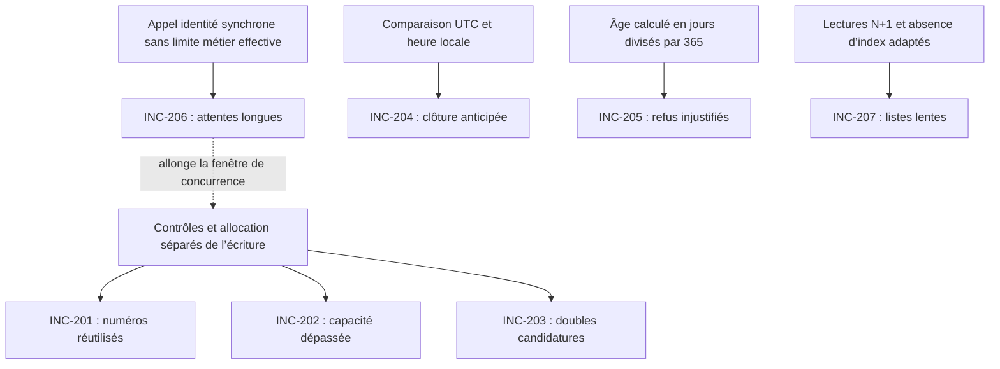

# Analyse des incidents — Consigne 3

## Méthode et reproductibilité

Cette analyse croise les règles métier et le déroulement des traitements décrits dans les sections 2 et 3 de [l’étude de cas](etude_de_cas_pratique.md), les événements du journal fourni et les lectures de la base locale importée. Le code de la plateforme d’origine n’est pas disponible : les causes techniques s’appuient sur le dossier, et leurs manifestations sur les traces.

Commandes à exécuter depuis la racine du dépôt :

```sh
# Six indicateurs de la consigne 2
php artisan journal:analyser journal_production.log

# Procédure, constats, causes, limites, preuves et liens des huit incidents
php artisan incidents:diagnostiquer journal_production.log

# Même diagnostic, complété par les comptages, dates et index de la base configurée
php artisan incidents:diagnostiquer journal_production.log --base

# Rapport complet exploitable par un autre outil, sans limite de preuves
php artisan incidents:diagnostiquer journal_production.log --base --json
```

`--base` effectue uniquement des lectures métier et de schéma ; sur PostgreSQL, elles sont regroupées dans une transaction en lecture seule avec un instantané cohérent. Cette option décrit **l’état actuel de la base configurée** : sa provenance doit être vérifiée avant de l’assimiler à l’export du sujet. Aucune réparation ni migration n’est exécutée. Sans cette option, le diagnostic reste utilisable sans connexion à une base.

L’empreinte SHA-256 du journal analysé est :

```text
c97fd8d3a35af7eccc573f89291924671f84b40114f94cb380e18dc284295205
```

Les chiffres et numéros de ligne ci-dessous correspondent à ce fichier. Chaque commande affiche son empreinte pour identifier la source utilisée. Tous les horaires présentés ci-dessous sont en **heure du Bénin, UTC+01:00**, sauf mention UTC explicite. Les débuts sont reconstruits : `fin journalisée − durée`. Ils ne donnent pas l’instant exact de chaque contrôle interne.

Les commandes calculent les preuves à partir du fichier passé en argument ; elles ne renvoient pas des résultats chiffrés préenregistrés. Les explications métier proviennent du dossier et sont présentées séparément. Un chevauchement confirme une exécution simultanée, pas le contenu des lectures SQL ni l’absence de tout verrou.

## INC-201 — Numéros de table identiques

**Verdict : anomalie confirmée ; scénario de concurrence fortement étayé.** La règle exige un numéro unique dans chaque centre, tous concours confondus.

```sh
php artisan incidents:diagnostiquer journal_production.log --incident=INC-201
php artisan journal:tracer journal_production.log --centre=P --numero=P-0464
```

**Constats.** Dix numéros sont réutilisés dans la fenêtre du journal : 32 créations se partagent ces numéros, soit 22 attributions au-delà d’une attribution par numéro. Les dix groupes comportent des requêtes qui se chevauchent. Ces comptes se recoupent avec les doubles candidatures ; ils ne doivent pas être additionnés comme des populations distinctes.

Exemple de Parakou, le 19 novembre :

| Requête | Ligne HTTP | Début reconstruit | Fin | Durée identité | Numéro |
| --- | --- | --- | --- | --- | --- |
| `a93cfec6` | 4478 | 09:21:14.000 | 09:21:47.432 | 33 410 ms, ligne 4477 | P-0464 |
| `a061413f` | 4473 | 09:21:16.300 | 09:21:39.081 | 22 766 ms, ligne 4472 | P-0464 |

La seconde demande commence avant la fin de la première et termine avant elle. Lire le journal uniquement dans l’ordre des lignes masquerait cet ordre de démarrage.

**Cause racine.** L’étape 6 calcule `maximum du centre + 1`, puis l’étape 7 attend le service d’identité avant l’insertion à l’étape 8. Sans réservation atomique du numéro, deux demandes peuvent calculer la même valeur. L’absence de contrainte d’unicité permet ensuite de conserver les deux attributions. Le schéma inspecté ne contient effectivement que la clé primaire des inscriptions comme index unique.

**Limite.** Les valeurs lues à l’étape 6 et les verrous ne sont pas tracés. La séquence exacte des instructions SQL est déduite du dossier, pas observée directement.

## INC-202 — Lokossa dépasse sa capacité

**Verdict : dépassement confirmé dans la base locale ; admission concurrente fortement étayée.** La capacité porte sur toutes les inscriptions du centre, pas sur chaque concours séparément.

```sh
php artisan incidents:diagnostiquer journal_production.log --incident=INC-202 --base
php artisan journal:tracer journal_production.log --centre=L --debut="2026-11-19 09:10:00" --fin="2026-11-19 09:13:00"
```

**Constats.** La base consultée contient **307 inscriptions et 307 NPI distincts pour une capacité de 300**, soit 7 places de dépassement. Le journal montre 11 créations à Lokossa, toutes associées à une identification lente : cinq reçoivent L-0297 et six reçoivent L-0298.

Les cinq premières démarrent entre 09:11:01.871 et 09:11:22.658 ; la première ne se termine qu’à 09:11:23.695. Les cinq demandes sont donc déjà engagées avant ce premier succès. Les lignes HTTP concernées sont 4405, 4407, 4409, 4413 et 4426. Les six autres créations figurent aux lignes 4421, 4411, 4431, 4424, 4429 et 4433, dans l’ordre de leurs débuts reconstruits.

**Cause racine.** Le comptage de capacité à l’étape 5 et l’insertion à l’étape 8 ne constituent pas une réservation atomique. Des demandes concurrentes peuvent toutes être acceptées sur un état encore disponible, puis être enregistrées après l’attente HTTP. Une contrainte unique sur les numéros, à elle seule, ne garantirait pas la capacité du centre.

**Liens.** La lenteur d’identité prolonge la fenêtre de concurrence ; les numéros répétés témoignent du même groupe de demandes concurrentes. En revanche, **les doubles candidatures n’expliquent pas le dépassement de Lokossa dans l’état consulté**, puisque les 307 NPI sont distincts.

**Limites.** Le journal ne contient pas les comptages lus par chaque demande et commence après le début de campagne. On ne doit ni utiliser le maximum des numéros comme total d’inscrits, ni désigner arbitrairement sept inscriptions à supprimer. Les décisions d’accueil relèvent de la direction des concours.

## INC-203 — Double inscription après une nouvelle validation

**Verdict : doubles candidatures confirmées ; scénario de demandes concurrentes fortement étayé.** Un NPI doit avoir une seule inscription par concours, même si le centre change.

```sh
php artisan incidents:diagnostiquer journal_production.log --incident=INC-203
php artisan journal:tracer journal_production.log --npi=2256599771 --concours=DOUANES
```

**Constats.** Sept couples NPI–concours ont deux créations réussies, soit sept inscriptions excédentaires dans cette fenêtre. Les sept paires se chevauchent. Douze des quatorze requêtes concernées ont un appel d’identité d’au moins cinq secondes.

Exemple du 19 novembre : `d2920789`, ligne 4437, s’exécute de 09:13:14.679 à 09:13:41.933 ; `bf13f780`, ligne 4440, de 09:13:27.089 à 09:14:18.057. Le NPI et le concours sont identiques ; les deux réponses sont HTTP 201. Les appels d’identité durent respectivement 27 231 et 50 934 ms.

**Cause racine.** Le contrôle d’existence à l’étape 4 est séparé de l’écriture par les étapes 5 à 7. La deuxième demande peut franchir le contrôle avant que la première soit enregistrée. L’absence de contrainte d’unicité NPI–concours laisse ensuite persister les deux lignes. Une protection contre les validations répétées est également nécessaire pour rendre les nouvelles tentatives maîtrisées.

**Limite.** Le journal prouve deux demandes et deux succès, mais pas le geste d’un double clic dans le navigateur. Une relance ou une autre origine de requête reste possible.

## INC-204 — Clôture anticipée du Trésor

**Verdict : refus prématurés confirmés ; confusion UTC/heure locale cohérente avec l’ensemble des éléments.**

```sh
php artisan incidents:diagnostiquer journal_production.log --incident=INC-204 --base
php artisan journal:tracer journal_production.log --requete=9df2a989
```

**Constats.** La clôture en base vaut `2026-11-20 22:59:00` **UTC**, soit le 20 novembre à **23:59:00 au Bénin**. Le journal contient 147 refus de clôture injustifiés pour 100 NPI distincts. Les débuts de ces demandes vont de 22:59:05.264 à 23:58:58.166, donc avant l’échéance officielle. Le premier est `9df2a989`, ligne 12170 ; le dernier est `6101a079`, ligne 12389.

**Cause racine.** À l’étape 2, une comparaison de l’heure locale du serveur avec la valeur UTC non convertie interprète 22:59 UTC comme 22:59 locale : la fermeture est avancée d’une heure. L’heure en base est cohérente avec l’échéance annoncée ; c’est l’interprétation des instants lors de la comparaison qui est en cause.

**Limites.** La syntaxe exacte de cette comparaison n’est pas disponible. Le début reconstruit reste une approximation de l’instant du contrôle interne ; pour les exemples cités, l’écart à l’échéance officielle est largement supérieur aux quelques millisecondes de traitement.

## INC-205 — Refus injustifié pour l’âge

**Verdict : erreur de calcul démontrée par le dossier et les refus observés.** L’âge maximal est de 35 années révolues au 31 décembre, pas une durée maximale de `35 × 365` jours.

```sh
php artisan incidents:diagnostiquer journal_production.log --incident=INC-205
php artisan journal:tracer journal_production.log --requete=f9d143c5
```

**Constats.** Trente-six candidats sont refusés alors qu’ils ont au plus 35 ans à la date de référence. Exemple : la requête `f9d143c5`, ligne 526, refuse le 18 novembre à 09:14:06.000 un candidat né le 21 juin 1991. Son âge civil au 31 décembre 2026 est 35 ans ; le calcul du dossier donne environ **35,553425**.

**Cause racine.** L’étape 3 compare un âge fractionnaire calculé en jours divisés par 365 à un âge civil entier. Les mois écoulés depuis l’anniversaire et les années bissextiles provoquent un dépassement artificiel. La correction doit comparer les années révolues à la date de référence, ou une borne de naissance équivalente.

**Limite.** Les 36 refus proviennent de la fenêtre fournie, pas nécessairement de toute la campagne. Le candidat du signalement est né le 20 juin ; l’exemple de preuve ci-dessus est un autre candidat, né le 21 juin, et ne doit pas être présenté comme la même personne.

## INC-206 — Inscriptions et convocations très lentes

**Verdict : dépendance bloquante au service d’identité démontrée ; indisponibilité générale continue non démontrée.**

```sh
php artisan incidents:diagnostiquer journal_production.log --incident=INC-206
php artisan journal:tracer journal_production.log --requete=a061413f
```

**Constats.** Soixante appels d’identité durent au moins cinq secondes et sont corrélés à 41 inscriptions et 19 consultations de convocation. Leur enveloppe observée va du 19 novembre à 09:09:48.265 à 09:39:49.805. L’appel le plus long dure **61 690 ms**.

Pour `a061413f`, l’appel d’identité dure 22 766 ms et la requête d’inscription 22 781 ms : l’attente externe explique presque toute sa durée. Le diagnostic expose cette différence pour chaque requête corrélée.

**Cause racine applicative.** Les deux parcours attendent synchroniquement le service d’identité. Les traces montrent que l’application laisse cette attente dépasser cinq secondes ; le délai métier et le repli vers « en attente de vérification » ne sont donc pas appliqués aux inscriptions observées. Le rappel externe à chaque convocation étend la dépendance à la consultation de documents.

**Liens.** Cette attente intervient après les contrôles d’inscription et avant l’écriture. Elle prolonge la fenêtre pendant laquelle plusieurs demandes peuvent passer les contrôles et encourage potentiellement les nouvelles tentatives. Les requêtes communes sont identifiées dans la section des liens.

**Limites.** La cause interne de la lenteur du service national n’est pas connue. Sans métriques de workers, de files d’attente ou de charge, une saturation du serveur unique reste une hypothèse. L’enveloppe des appels lents n’est pas une preuve que tout le service a été indisponible sans interruption ni que tous les candidats ont été touchés.

## INC-207 — Liste des inscrits trop lente

**Verdict : dégradation mesurée ; traitement N+1 décrit dans le dossier, aggravé par l’absence d’index adaptés.**

```sh
php artisan incidents:diagnostiquer journal_production.log --incident=INC-207 --base
php artisan journal:tracer journal_production.log --requete=cf4fde16
```

**Constats.** Pour Cotonou, les 18 réponses mesurées dépassent l’objectif strict de moins de deux secondes : moyenne **25 375,44 ms**, maximum **46 455 ms**. Le maximum correspond à `cf4fde16`, ligne 10512, le 20 novembre, de 17:35:42.124 à 17:36:28.579, pour 2 408 lignes retournées.

**Cause racine.** Le traitement décrit lit les inscriptions, puis le candidat séparément pour chacune : pour cet exemple, cela correspond à **2 409 lectures selon le dossier**, pas à une mesure SQL. La base inspectée ne fournit aucun index adapté au filtrage centre–concours ni à la recherche du candidat par NPI : seuls les index des clés primaires apparaissent pour les deux tables. Les lectures répétées et leurs parcours de données expliquent un coût croissant avec la taille de la liste.

**Limites.** Le journal HTTP ne contient ni plans d’exécution ni temps SQL. Il ne permet pas de répartir précisément les 46,455 secondes entre base, échanges et rendu. Le respect de l’objectif à 5 000 inscrits devra être testé après correction ; il n’est pas démontré ici.

## INC-208 — Deux concours dont l’épreuve a lieu le même jour

**Verdict : comportement conforme, sans correction fonctionnelle.**

```sh
php artisan incidents:diagnostiquer journal_production.log --incident=INC-208 --base
php artisan journal:tracer journal_production.log --requete=c53db581
```

**Constats.** Trois refus mentionnent une épreuve le même jour. La base indique que DOUANES et IMPOTS ont tous deux leur épreuve le **12 décembre 2026**, contre le 19 décembre pour TRESOR. Avec `--base`, les preuves exposent pour chaque refus l’inscription antérieure dans l’autre concours du même jour, en contrôlant que sa création précède la demande refusée.

Pour `c53db581`, ligne 1217, la demande IMPOTS est refusée le 18 novembre à 12:06:55.643 ; la base contient déjà une inscription DOUANES du même NPI créée le 17 novembre à 20:22:08 UTC. Les deux autres refus, `19d52130` et `7b802f0d`, ont également un antécédent correspondant dans la base consultée.

**Explication.** Le contrôle de l’étape 4 applique la règle explicite interdisant deux concours dont les épreuves ont lieu le même jour. Ce signalement n’est pas une anomalie et ne doit pas conduire à retirer ce contrôle.

**Limite.** Si la base est ensuite réparée ou remplacée, les antécédents affichés peuvent changer ; conserver la provenance des éléments utilisés pour cette conclusion.

## Liens entre incidents

Le diagnostic calcule les intersections d’identifiants de requête : il ne déduit pas une causalité de la seule proximité des horaires.

| Relation | Preuve observée | Interprétation |
| --- | --- | --- |
| INC-206 → INC-201 | 30 des 32 créations portant un numéro réutilisé ont un appel d’identité lent. | L’attente allonge la fenêtre entre calcul du numéro et insertion ; le défaut d’atomicité et l’absence d’unicité restent les causes de la collision. |
| INC-206 → INC-202 | Les 11 créations visibles de Lokossa ont un appel lent et partagent deux numéros. | Même fenêtre de concurrence entre contrôle de capacité et insertion ; l’attente est un facteur aggravant. |
| INC-206 → INC-203 | 12 des 14 créations des doubles candidatures ont un appel lent. | La première demande peut rester en cours lors d’une nouvelle tentative ; les deux autres créations montrent que le défaut ne dépend pas exclusivement d’une lenteur supérieure à cinq secondes. |
| INC-201 ↔ INC-203 | Les 14 créations des doubles candidatures figurent aussi dans des groupes de numéros réutilisés. | Certaines demandes produisent deux anomalies. Une collision entre deux candidats différents n’est toutefois pas une double candidature. |
| INC-201 ↔ INC-202 | Les 11 créations de Lokossa apparaissent dans les groupes L-0297 et L-0298. | Deux effets d’admissions concurrentes ; le numéro dupliqué ne constitue pas, à lui seul, la cause du dépassement de capacité. |
| INC-203 → INC-202 | Aucune double candidature visible à Lokossa ; 307 NPI distincts dans la base. | Un doublon peut consommer des places en général, mais cette explication n’est pas retenue pour Lokossa. |
| INC-207 → INC-206 | Aucun compteur de charge ou de workers disponible. | Une concurrence pour les ressources est possible sur le serveur unique, mais ce lien reste non démontré. |



Les flèches pleines représentent les mécanismes décrits dans le dossier et étayés par les constats ; la flèche pointillée représente le facteur aggravant temporel. Les journaux ne constituent pas une trace de chaque instruction SQL.

Aucun lien causal n’est établi entre les erreurs de fuseau (INC-204), de calcul d’âge (INC-205) et les défauts de concurrence. INC-208 est un comportement conforme. La lenteur du service d’identité ne doit donc pas être utilisée comme explication unique de tous les signalements.
